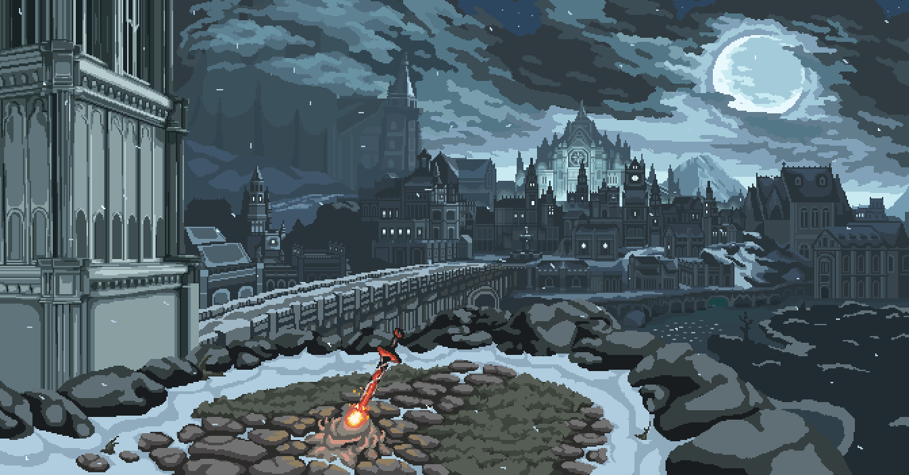

<!--WALLPAPER-->
<p align='center'>
  
</p>
<!--/WALLPAPER-->

## Hi there 👋

<!--START_SECTION:waka-->


**🐱 My GitHub Data** 

> 📦 1.1 MB Used in GitHub's Storage 
 > 
> 🏆 2,078 Contributions in the Year 2026
 > 
> 🚫 Not Opted to Hire
 > 
> 📜 10 Public Repositories 
 > 
> 🔑 39 Private Repositories 
 > 
**I'm an Early 🐤** 

```text
🌞 Morning                36099 commits       ████████░░░░░░░░░░░░░░░░░   33.17 % 
🌆 Daytime                64537 commits       ███████████████░░░░░░░░░░   59.31 % 
🌃 Evening                7359 commits        ██░░░░░░░░░░░░░░░░░░░░░░░   06.76 % 
🌙 Night                  820 commits         ░░░░░░░░░░░░░░░░░░░░░░░░░   00.75 % 
```
📅 **I'm Most Productive on Thursday** 

```text
Monday                   22574 commits       █████░░░░░░░░░░░░░░░░░░░░   20.75 % 
Tuesday                  21848 commits       █████░░░░░░░░░░░░░░░░░░░░   20.08 % 
Wednesday                20319 commits       █████░░░░░░░░░░░░░░░░░░░░   18.67 % 
Thursday                 23062 commits       █████░░░░░░░░░░░░░░░░░░░░   21.19 % 
Friday                   17864 commits       ████░░░░░░░░░░░░░░░░░░░░░   16.42 % 
Saturday                 1764 commits        ░░░░░░░░░░░░░░░░░░░░░░░░░   01.62 % 
Sunday                   1384 commits        ░░░░░░░░░░░░░░░░░░░░░░░░░   01.27 % 
```


📊 **This Week I Spent My Time On** 

```text
🕑︎ Time Zone: Asia/Baku

💬 Programming Languages: 
Other                    16 hrs 41 mins      ███████████░░░░░░░░░░░░░░   44.75 % 
PHP                      7 hrs 11 mins       █████░░░░░░░░░░░░░░░░░░░░   19.27 % 
Markdown                 6 hrs 10 mins       ████░░░░░░░░░░░░░░░░░░░░░   16.57 % 
Blade Template           1 hr 21 mins        █░░░░░░░░░░░░░░░░░░░░░░░░   03.64 % 
Text                     1 hr 15 mins        █░░░░░░░░░░░░░░░░░░░░░░░░   03.38 % 

🔥 Editors: 
Firefox                  16 hrs 46 mins      ███████████░░░░░░░░░░░░░░   44.96 % 
Claude Code              13 hrs 44 mins      █████████░░░░░░░░░░░░░░░░   36.85 % 
PhpStorm                 4 hrs 59 mins       ███░░░░░░░░░░░░░░░░░░░░░░   13.38 % 
TablePlus                55 mins             █░░░░░░░░░░░░░░░░░░░░░░░░   02.48 % 
DesktopSSHClient         29 mins             ░░░░░░░░░░░░░░░░░░░░░░░░░   01.34 % 

🐱‍💻 Projects: 
azeriqaz.loc             23 hrs 24 mins      ████████████████░░░░░░░░░   62.77 % 
scenes                   5 hrs 20 mins       ████░░░░░░░░░░░░░░░░░░░░░   14.30 % 
Azeriqaz                 3 hrs 18 mins       ██░░░░░░░░░░░░░░░░░░░░░░░   08.85 % 
Unknown Project          1 hr 32 mins        █░░░░░░░░░░░░░░░░░░░░░░░░   04.12 % 
WindowsScenes            1 hr 25 mins        █░░░░░░░░░░░░░░░░░░░░░░░░   03.83 % 

💻 Operating System: 
Windows                  37 hrs 18 mins      █████████████████████████   100.00 % 
```

🤖 **AI Coding This Week** 

```text
⏱ AI Coding Time: 14 hrs 55 mins (40.03%)

✍️ 32,915 lines written by AI, 860 lines written by hand (97.45% AI-written)

🔤 8,222,413 Input Tokens, 2,404,670 Output Tokens

💵 $202.97 Estimated AI Cost This Week

🧠 42 AI Sessions, 240 AI Prompts

Opus                     33,262 lines        █████████████████████████   100.00 % 
Sonnet                   0 lines             ░░░░░░░░░░░░░░░░░░░░░░░░░   00.00 % 

🔎 AI Coding Insights:
🤖 AI-Driven — 97.45% of written lines came from AI
📚 Verbose Prompter — average 3,869 characters per prompt
🔁 Iterative Prompter — average 6 prompts per session
🚀 High AI Trust — 12.52% of changed lines were hand-edited
```

**I Mostly Code in PHP** 

```text
PHP                      25 repos            ████████████░░░░░░░░░░░░░   50.00 % 
JavaScript               17 repos            ████████░░░░░░░░░░░░░░░░░   34.00 % 
Go                       1 repo              ░░░░░░░░░░░░░░░░░░░░░░░░░   02.00 % 
Blade                    1 repo              ░░░░░░░░░░░░░░░░░░░░░░░░░   02.00 % 
Vue                      1 repo              ░░░░░░░░░░░░░░░░░░░░░░░░░   02.00 % 
```


**Timeline**


 Last Updated on 19/10/2026 03:34:14 UTC
<!--END_SECTION:waka-->

### 🛠️ Techs and Tools


